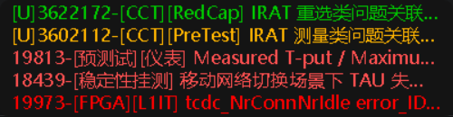

# Rainmeter Buglist



一个 Rainmeter 桌面小部件：定时查询 Bugzilla，把分配给你的、仍需关注的 bug 列在桌面上，点击直接打开对应 bug 页面。

- 同时查询多个 Bugzilla 实例
- 按状态着色，按优先级排序（NeedInfo → Assigned → RootCaused → NEW）
- 标题过长会截断，鼠标悬停显示完整标题
- 查询失败时底部用红字提示（正常时不显示，不占空间）
- 刷新/启动时先显示上次成功结果的缓存，不会白屏等待
- 面板高度随实际行数变化
- 账号与 API Key 全部在本地 `config.json`，不进入仓库

## 目录结构

| 文件 | 说明 |
| --- | --- |
| `bug_list.ini` | Rainmeter 皮肤定义（布局、刷新周期、Python 调用） |
| `bug_list.lua` | 解析 Python 输出，填充分行文本 / 颜色 / 点击链接 / 悬浮提示 / 状态行 |
| `bugzilla_rainmeter.py` | 查询 Bugzilla，输出 `@status|...` 与 `URL|显示文本` 行，并写缓存 |
| `config.json` | **本地私有配置**（服务器地址、账号、API Key），不提交 |
| `config.example.json` | 配置模板 |
| `cache.txt` | 上次成功结果的缓存，运行时生成，不提交 |
| `.gitignore` | 忽略 `config.json`、`cache.txt` 等本地文件 |

## 依赖

- [Rainmeter](https://www.rainmeter.net/) 4.5+（内置 RunCommand 插件）
- Python 3.8+
- `pip install python-bugzilla`

## 使用

1. 把本目录放到 Rainmeter 的 `Skins` 目录下，例如
   `C:\Users\<你>\Documents\Rainmeter\Skins\buglist`。

2. 复制配置模板并填写自己的信息：

   ```bash
   cp config.example.json config.json
   ```

   `sources` 里每一项对应一台 Bugzilla：

   | 字段 | 说明 |
   | --- | --- |
   | `name` | 数据源名称，用于状态行报错 |
   | `tag` | 显示前缀，例如 `[U]`；不需要就留空 |
   | `url` | XML-RPC 地址，通常是 `<站点>/xmlrpc.cgi` |
   | `api_key` | Bugzilla API Key（站点 Preferences → API Keys 生成） |
   | `base` | bug 页面地址前缀，用于点击跳转 |
   | `assigned_to` | 要查询的账号邮箱（各站点账号可能不同） |

3. 修改 `bug_list.ini` 里的 Python 路径（只有这一处需按机器改）：

   ```ini
   [Variables]
   PythonPath=C:\...\python.exe
   ```

4. 在 Rainmeter 中加载 `buglist\bug_list.ini`。

## 显示规则

- 只显示"活跃状态"的 bug：`Assigned`、`RootCaused`/`Root-Caused`、`NeedInfo`/`Need_Info`、`NEW`、`ReOpen`/`REOPENED`。
  判断时会把状态名去掉 `-`、`_`、空格并转小写，因此不同 Bugzilla 的状态命名差异无需分别配置。规则见 `bugzilla_rainmeter.py` 的 `ACTIVE_STATUSES`。
- 已关闭的状态（Closed、Fixed、Verified、WONTFIX 等）不显示。
- 每 60 秒刷新一次；最多显示 8 行（`bug_list.ini` 的 `MaxBug`）。
- 排序：先按状态优先级，再按 bug id 倒序（新的在前）。

## 缓存与失败提示

- 平时不显示额外行；只有某个数据源查询失败时，底部才出现红字 `<时间> | 失败: 名称`。
- Python 每次成功查询后把结果写入 `cache.txt`；皮肤刷新/启动时先显示缓存，等新结果到达后自动替换。
- 所有数据源都失败时，继续显示上一次成功的列表，并显示红色失败提示。
- 缓存使用系统 ANSI 编码写入（Rainmeter 的 Lua 通道按 ANSI 解释字符串），因此中文系统显示最佳。

## 隐私

`config.json` 含有账号与 API Key，已被 `.gitignore` 排除，不会被提交。请勿提交；如果不慎泄露，请到 Bugzilla 的 API Keys 页面吊销并重新生成。
